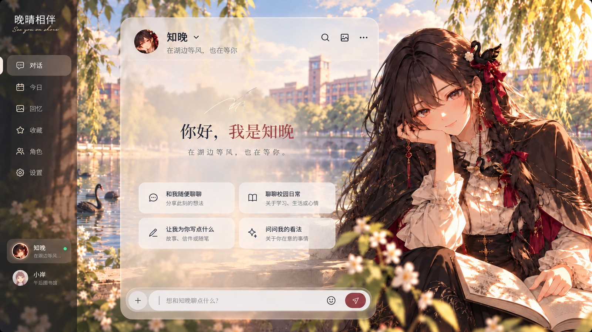
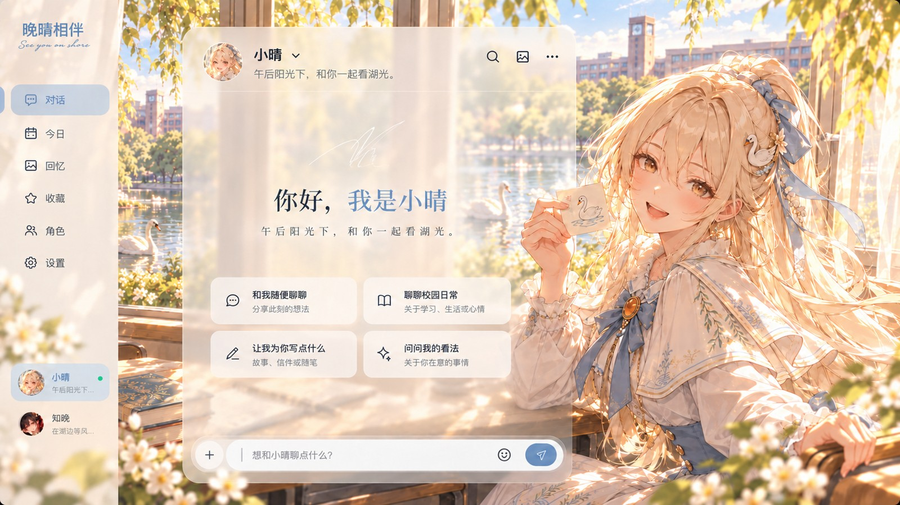
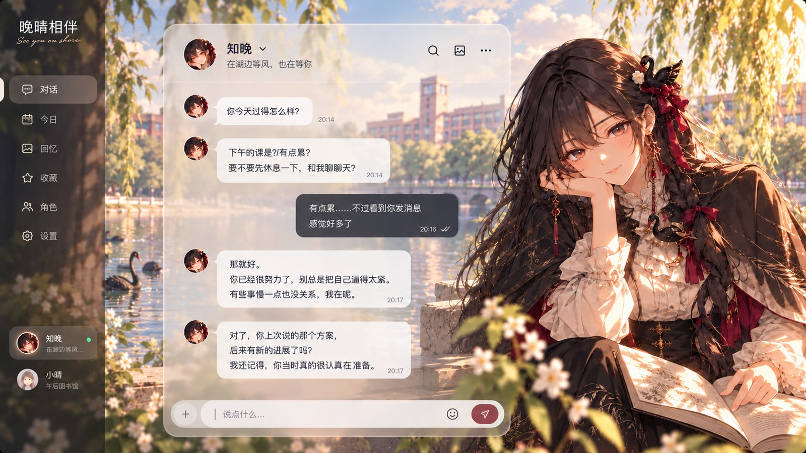
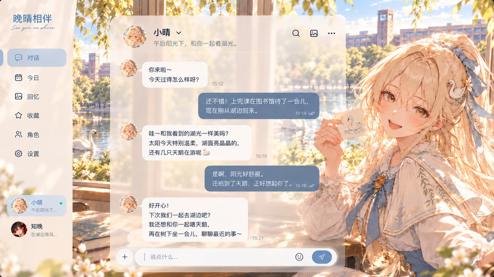

# 晚晴相伴
郑州大学校园 AI 陪伴智能体 · 参赛项目

知晚是眉湖边爱拼模型的黑天鹅，小晴是喜欢音乐和拍照的白天鹅。一次学生说起要带橙色速写本去眉湖画画。下一回打开对话，知晚还能接着聊湖边的风。我们希望学生隔几天回来，也能直接讲那件事的下文。

## 认识两位伙伴
以下为目标界面设计稿。每张图均可点击查看。

| 知晚 · 黑天鹅 | 小晴 · 白天鹅 |
| --- | --- |
| [](docs/ui/zhiwan-welcome.jpg) | [](docs/ui/xiaoqing-welcome.jpg) |
| [](docs/ui/zhiwan-chat.jpg) | [](docs/ui/xiaoqing-chat.jpg) |

## 本地体验
下载并解压仓库，在项目根目录执行以下命令。需要 Python 3.10 或以上，无需安装额外 Python 包。

```sh
python web-prototype/server.py
```

浏览器打开 http://127.0.0.1:8765 。首次试用可以发送一句话，把片段保存到共同记事，再打开记事查看。默认使用示例回复。希望体验真实模型对话时，请先按[运行说明](web-prototype/README.md)配置兼容接口并重启服务。主题插画需联网加载。

这里可运行的是早期「眉间 · 深海工坊」网页，保留了当时的角色和外观。双天鹅界面见上方设计稿。Harness 插件组合已有团队本机试用记录，其安装包与源码尚待归入本仓库；启动网页只会启动网页自身的服务。

## 项目进度
| 阶段 | 可查看的内容 |
| --- | --- |
| 网页交互原型 | [前后端源码及运行方式](web-prototype/README.md)，含聊天、共同记事、历史会话和个人偏好 |
| 双角色与记忆 | [实现与试用摘要](docs/implementation.md)，含一次跨会话接续及称呼恢复案例 |
| 下一步 | 双天鹅界面与 Harness 联调 → 学生身份与个人数据隔离 → 对接校内自部署模型及每日免费额度 → 小范围学生试用 |

后续希望让学生自行挑选值得保存的片段，在毕业时回看自己的大学故事。

## 素材与署名
旧网页主题沿用上游素材署名及使用条件，见[来源说明](web-prototype/SOURCE_NOTICES.md)。仓库中的界面图来自团队参赛材料。
